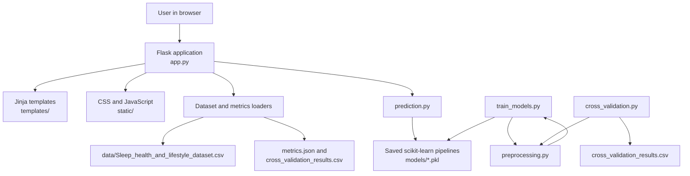

# Sleep Quality Pattern Recognition

A Flask-based machine-learning dashboard that analyzes sleep and lifestyle records and predicts one of three project-defined sleep-quality categories:

- **Poor**
- **Moderate**
- **Good**

The application uses saved scikit-learn pipelines, so the web interface does not retrain models when a user opens a page or submits a prediction.

## Contents

- [Overview](#overview)
- [Architecture](#architecture)
- [Data and preprocessing](#data-and-preprocessing)
- [Models](#models)
- [Project structure](#project-structure)
- [Setup](#setup)
- [Run the application](#run-the-application)
- [Evaluation outputs](#evaluation-outputs)
- [Web routes](#web-routes)
- [Limitations](#limitations)

## Overview

The dashboard provides:

- Dataset statistics and sleep-category distributions.
- A prediction form using the five saved classifiers.
- Selectable numeric-feature distributions on the Dataset page.
- A 10-row dataset preview with search.
- Model-specific feature importance for supported classifiers.
- A Performance page with model descriptions and cross-validation metrics.
- A responsive Flask/Jinja interface using vanilla JavaScript and Chart.js.

## Architecture

The project follows a small layered architecture:



### Request flow

1. A browser requests a Flask route such as `/`, `/dataset`, or `/performance`.
2. `app.py` loads the required dataset, metrics, or saved model artifact.
3. `preprocessing.py` supplies the same feature names and label rules used by the training scripts.
4. Flask passes real values to a Jinja template.
5. The template renders the page; Chart.js creates client-side charts from server-provided values.

### Prediction flow

1. The user submits the prediction form at `/predict`.
2. The server validates numeric ranges, categories, and the selected model.
3. The submitted values are converted to the trained feature schema.
4. `prediction.py` loads the selected `.pkl` pipeline and calls `predict()`.
5. If supported by the classifier, the highest class probability is returned.
6. The result is rendered with an educational-use disclaimer.

## Data and preprocessing

The source dataset is:

```text
data/Sleep_health_and_lifestyle_dataset.csv
```

It contains 374 records and 12 model inputs.

### Numeric inputs

- Age
- Sleep Duration
- Physical Activity Level
- Stress Level
- Systolic_BP
- Diastolic_BP
- Heart Rate
- Daily Steps

### Categorical inputs

- Gender
- Occupation
- BMI Category
- Sleep Disorder

The preprocessing pipeline:

1. Loads and cleans the CSV column names.
2. Replaces missing Sleep Disorder values with `None`.
3. Splits Blood Pressure values such as `126/83` into systolic and diastolic numeric columns.
4. Derives the target label from `Quality of Sleep`.
5. Median-imputes and scales numeric features.
6. Most-frequent-imputes and one-hot encodes categorical features.
7. Creates a stratified 75/25 train/test split.

The target labels are project-defined, not clinical standards:

- **Poor:** Quality of Sleep scores 4–5
- **Moderate:** scores 6–7
- **Good:** scores 8–10

## Models

Five classifiers are trained using the same preprocessing pipeline:

| Model | Simple description |
| --- | --- |
| Logistic Regression | Linear classification using weighted feature relationships. |
| Decision Tree | Rule-based classification using sequential if-then splits. |
| Random Forest | An ensemble of many decision trees whose votes are combined. |
| SVM | Margin-based classification that separates categories in transformed feature space. |
| KNN | Classifies a record using the categories of nearby training records. |

The Dataset page supports model-specific importance where the model exposes a native method:

- Decision Tree and Random Forest use split-based feature importance.
- Logistic Regression uses mean absolute coefficients.
- SVM and KNN report that native feature importance is unavailable.

## Project structure

```text
Sleep_recognition/
├── app.py                         # Flask routes, validation, and page context
├── preprocessing.py               # Cleaning, labels, and sklearn transformers
├── prediction.py                  # Loading pipelines and making predictions
├── evaluation.py                  # Held-out test-set metrics
├── train_models.py                # Train and save five model pipelines
├── cross_validation.py            # Stratified five-fold evaluation
├── requirements.txt               # Python dependencies
├── README.md
├── .gitignore
├── data/
│   └── Sleep_health_and_lifestyle_dataset.csv
├── models/
│   ├── logistic_regression.pkl
│   ├── decision_tree.pkl
│   ├── random_forest.pkl
│   ├── svm.pkl
│   ├── knn.pkl
│   ├── metrics.json
│   └── cross_validation_results.csv
├── templates/                     # Jinja HTML pages
└── static/
    ├── css/style.css
    └── js/script.js
```

## Setup

The commands below are for Windows PowerShell.

### 1. Create the virtual environment

```powershell
python -m venv venv
```

### 2. Activate it

```powershell
.\venv\Scripts\Activate.ps1
```

If PowerShell blocks activation, use the environment's interpreter directly:

```powershell
.\venv\Scripts\python.exe -m pip install --upgrade pip
```

### 3. Install dependencies

```powershell
python -m pip install -r requirements.txt
```

Dependencies include Flask, pandas, scikit-learn, and joblib. Chart.js is loaded by the templates from its CDN when the app is viewed in a browser.

## Run the application

If the saved model files already exist, start Flask directly:

```powershell
python app.py
```

Open:

```text
http://127.0.0.1:5000/
```

To retrain the models and refresh evaluation artifacts:

```powershell
python train_models.py
python cross_validation.py
python app.py
```

## Deploy on Render

This repository includes `render.yaml` and `Procfile` for deployment with
Gunicorn. The dataset and saved model files in `data/` and `models/` must be
committed because the application loads them at runtime.

1. Commit and push the project to GitHub.
2. Sign in to [Render](https://render.com/).
3. Choose **New +** and select **Blueprint**.
4. Select the GitHub repository `Akashj-aj/Sleep_recognition`.
5. Confirm the service from `render.yaml` and create the web service.

Render uses these commands:

```text
Build: pip install -r requirements.txt
Start: gunicorn app:app
```

After deployment, open the HTTPS URL provided by Render. Do not use
`python app.py` as the production server; that command is intended for local
development.

## Evaluation outputs

The project keeps two evaluation methods separate:

- `models/metrics.json` contains held-out test-set accuracy, macro precision, macro recall, macro F1, classification reports, and confusion matrices.
- `models/cross_validation_results.csv` contains stratified five-fold training-split results, including mean accuracy, accuracy standard deviation, macro precision, macro recall, and macro F1.

The values summarize this experiment. They are not guarantees about the accuracy of future individual predictions.

## Web routes

| Route | Purpose |
| --- | --- |
| `/` | Dashboard overview and pattern-recognition pipeline. |
| `/predict` | Validate inputs and make a prediction with a selected model. |
| `/dataset` | Explore distributions, feature importance, and the 10-row preview. |
| `/performance` | Compare models and inspect the selected model description. |
| `/about` | Project overview, methods, and limitations. |
| `/patterns` | Compatibility redirect to the Dataset page. |
| `/confusion-matrix` | Compatibility redirect to the Performance page. |

## Limitations

- The dataset is relatively small and the Poor category has fewer examples.
- The data is observational; relationships should not be interpreted as proof of causation.
- The original dataset does not document the units for Physical Activity Level.
- Predictions are educational machine-learning outputs, not medical diagnoses.
- Model performance may vary on new data outside this dataset.
